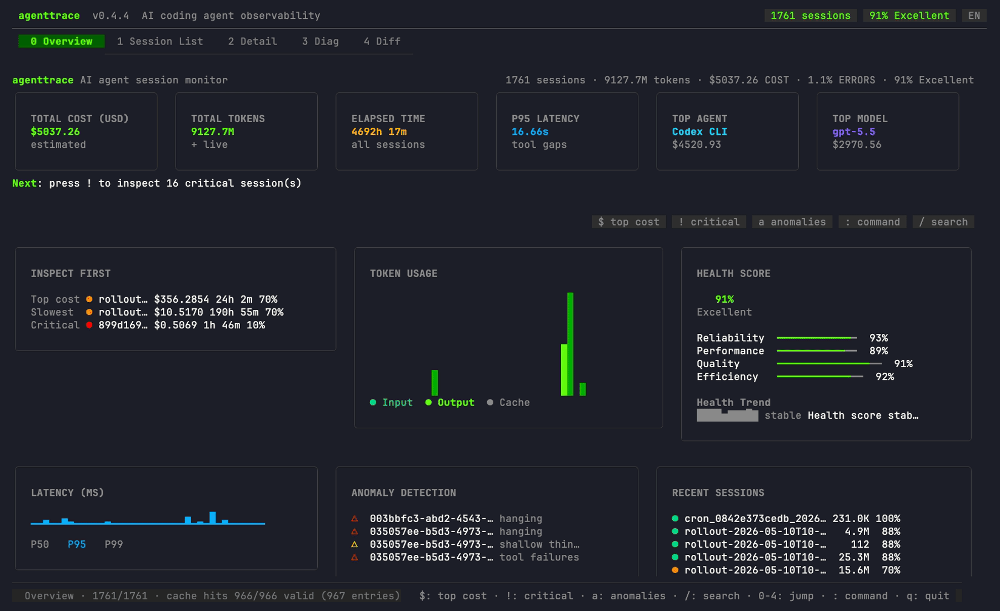
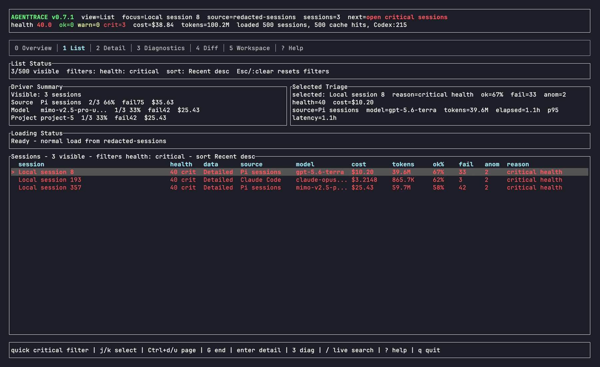
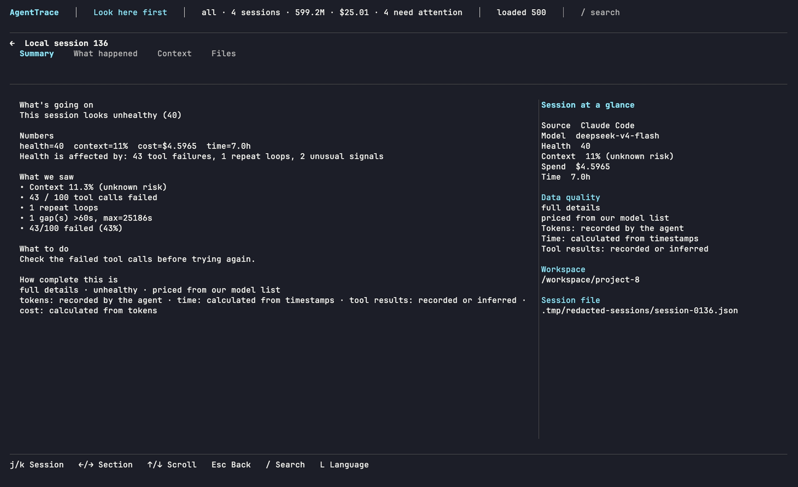
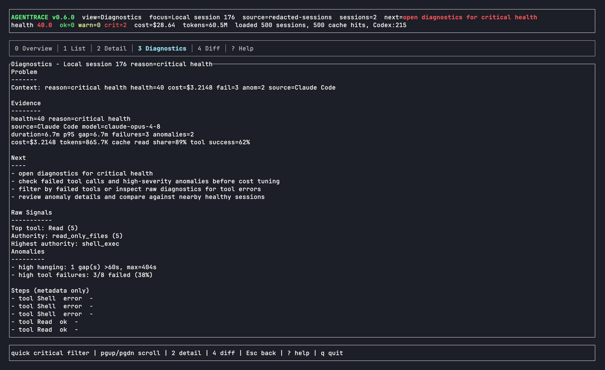

<p align="center">
  
</p>

<h1 align="center">AgentTrace</h1>

<p align="center">
  本地优先的 TUI 和报告工具，用来分析 AI 编程 Agent 会话历史、成本、Token、耗时和慢任务原因。
</p>

<p align="center">
  <a href="README.md">English</a> | 简体中文
</p>

<p align="center">
  <a href="https://github.com/luoyuctl/agenttrace/actions/workflows/ci.yml"></a>
  <a href="https://codecov.io/gh/luoyuctl/agenttrace"></a>
  <a href="https://scorecard.dev/viewer/?uri=github.com/luoyuctl/agenttrace"></a>
  <a href="https://github.com/luoyuctl/agenttrace/releases/latest"></a>
  
  
  <a href="https://github.com/luoyuctl/homebrew-tap"></a>
  <a href="https://www.npmjs.com/package/@zack78/agenttrace"></a>
</p>

<p align="center">
  
</p>

---

**agenttrace** 是一个本地优先的终端 TUI 和报告生成工具，用来分析 AI 编程 Agent 的会话历史。它会读取 Claude Code、Codex CLI、Qwen Code、Cline、Aider、Cursor exports、Hermes Agent、OpenCode、OpenClaw、Pi、Oh My Pi、Kimi CLI、Copilot-style logs 和通用 JSON/JSONL traces，主要帮你做两件事：汇总多个 Agent 历史会话的成本、Token 和耗时；定位某次任务为什么跑得慢。

CLI 和 TUI 来自同一个 `agenttrace` 二进制：不带报告动作时进入 TUI，传入 `--sessions`、`--overview` 等参数时输出 CLI 报告。

## 为什么需要 agenttrace？

AI 编程 Agent 越来越像一套小型构建系统：会调用工具、重试、卡住、花 token，但你最后往往只看到一段总结。

**agenttrace** 读取这些 Agent 已经写在本机的日志，把最贵、最慢、最值得看的会话排到前面。

它能帮你回答：

- **Agent 花了多少？** 按来源、模型、input/output/cache token、估算成本和真实耗时对比历史会话。
- **任务为什么慢？** 发现长时间空档、挂起会话、重试循环、慢工具调用、大参数和上下文压力。
- **这次有没有退化？** 在提供本地 baseline 时对比回归，再从报告里查看 incident timeline 和保守的 tool authority 分类。
- **先看哪一次？** 按成本、耗时、轮次、健康分、失败、异常、模型、来源或文本搜索排序。
- **能不能本地看？** 所有分析都在本机完成，不需要上传 prompt、代码和日志。

## 真实本机运行

```bash
agenttrace
```

可通过 `AGENTTRACE_PRICING_FILE=pricing-overrides.json` 提供模型别名和每百万 Token
价格覆盖：

```json
{"aliases":{"provider/raw-model":"my-model"},"prices":{"my-model":{"input":1,"output":2,"cw":0,"cr":0}}}
```

| 概览 | Critical 会话 |
|---|---|
|  |  |

| 会话详情 | 诊断 |
|---|---|
|  |  |

## 安装

macOS 和 Linux：

```bash
curl -fsSL https://raw.githubusercontent.com/luoyuctl/agenttrace/master/install.sh | sh
```

Windows PowerShell：

```powershell
irm https://raw.githubusercontent.com/luoyuctl/agenttrace/master/install.ps1 | iex
```

Windows CMD：

```bat
curl -fsSL https://raw.githubusercontent.com/luoyuctl/agenttrace/master/install.cmd -o install.cmd && install.cmd && del install.cmd
```

安装脚本会下载对应平台的发布版程序，按发布的校验和验证 SHA-256，并把安装目录
（`~/.local/bin`，Windows 上为 `%LOCALAPPDATA%\agenttrace`）加入 PATH。
Shell 安装脚本始终获取最新发布版（源码构建回退可用
`AGENTTRACE_SOURCE_REF=v0.10.1` 固定）；Windows 上用 `-Version v0.10.1`
（PowerShell）固定版本。

包管理器：

```bash
# macOS 和 Linux
brew install luoyuctl/tap/agenttrace

# macOS、Linux 和 Windows（需要 Node.js 18+）
npm install -g @zack78/agenttrace

# 从源码安装
cargo install --git https://github.com/luoyuctl/agenttrace agenttrace
```

可用 `agenttrace --version` 检查实际版本。

### 更新

| 安装方式 | 更新命令 |
| --- | --- |
| Homebrew | `brew upgrade luoyuctl/tap/agenttrace` |
| npm | `npm install -g @zack78/agenttrace@latest` |
| cargo | `cargo install --git https://github.com/luoyuctl/agenttrace agenttrace --force` |


预编译二进制与当前主机不兼容时（例如基于更新版本 libc 构建）不会
被静默安装：安装器会报告加载器的错误信息，install.sh 会自动回退到
从源码构建。

## Quickstart

```bash
agenttrace
```

### 标志写在会话路径之前

`agenttrace` 保持与 Go `flag` 兼容的参数解析：只有在第一个位置参数**之前**的选项标志才会被识别。位置参数之后的标志不会被解析，这类调用会以用法错误退出，并指明被丢弃的参数：

```bash
agenttrace sessions.jsonl -f json    # 被拒绝：`-f json` 位于路径之后
agenttrace -f json sessions.jsonl    # -f json 生效
```

`--limit` 只限制列表视图（例如 overview 的 `recent_sessions`）；它从不过滤聚合值、审计总额或建议。治理报告默认覆盖全部会话——需要显式、带披露的上限时使用 `--sample N`（JSON 中会输出 `audited_sessions` / `total_sessions` / `excluded_reason`）。

### 本地 MCP 服务器（rm-455）

`agenttrace mcp` 是一个本地只读 MCP 服务器：在 stdio 上讲换行分隔的
JSON-RPC 2.0，让编程 Agent 在烧掉 token 的那个会话里直接问“我的
token 花在哪了”。两个工具渲染 CLI 同一套本地发现的会话——
`usage_overview`（即 `--overview -f json` 文档）和 `by_model_breakdown`
（按模型统计成本与会话数）——并解析与 CLI 相同的分层配置：
`--config` 层或 `--pricing-file` 覆盖对两条通道定价一致（rm-781）。
`initialize` 协商双方共同支持的最新的协议版本（`2026-07-28`、
`2025-11-25`、`2025-06-18`），绝不盲回显（rm-780）。服务器不打开任何
socket、不做任何网络探测、不在 agenttrace 会话缓存之外写任何东西；
stdin 关闭即退出；对非 UTF-8 的行回 `-32700`、对超过 1 MiB 传输上限的
行回 `-32600`，两种情况都保持服务而不是崩溃（rm-782；超上限拒绝契约
为 rm-923）。

标志放在 `mcp` 关键字之前：`-d/--dir` 与配置族（`--config`、
`--history-dir`、`--pricing-file`）生效，其余无法作用于服务器的标志
以退出码 2 拒绝，不再被静默丢弃（rm-781）。

```json
{
  "mcpServers": {
    "agenttrace": { "command": "agenttrace", "args": ["mcp"] }
  }
}
```

注册片段、完整协议面、错误码映射与一次工具调用的完整往返见
[docs/guides/mcp-server.md](docs/guides/mcp-server.md)（英文）。该关键字
与 `--mcp-governance` 报告过滤标志无关。

## CLI 标志参考

`agenttrace` 接受的每一个选项，附默认值与用途。本表与 `agenttrace --help`
保持一致；`check-docs-commands` CI 门禁在英文 README 表的行数与二进制
实际标志数漂移时失败（rm-207）——该门禁只核对英文表，本表是它的中文对照，
随英文表同步维护（rm-931，2026-10-19 落地）。

| 标志 | 默认值 | 用途 |
| --- | --- | --- |
| `-f, --format <FORMAT>` | `text` | 所请求视图的输出格式：text（默认）、json、csv、markdown/md、html、svg（可分享的用量卡片；需要 --overview）、otel（整个语料的 OTLP-JSON 导出；需要 --overview）或 tsv（--sessions 表，与其默认 text 渲染逐字节一致；需要 --sessions）。不支持的组合会响亮地失败，而不是回退到 text |
| `--card-theme <CARD_THEME>` | `auto` | rm-576：SVG 用量卡片（`-f svg`）的配色方案。`auto` 随附浅色调色板及 `prefers-color-scheme` 覆盖，静态文件可随查看者自适应；字节保持确定性 |
| `-d, --dir <DIR>` |  | 要扫描的会话目录，代替自动发现的 agent 主目录 |
| `--compare` |  | 将被检查的会话与健康基线摘要对比（叙述以 `-m` 参考模型为框架） |
| `--audit` |  | 在匹配会话上渲染治理审计报告（工具权限漂移与支出监督；`--sample` 可限定范围） |
| `--recommend` |  | 渲染从会话语料推导的成本与效率建议 |
| `--mcp-governance` |  | 审计跨会话的 MCP 服务器治理：哪些服务器可达、暴露了哪些工具、以及 allowlist 漂移 |
| `--context-trends` |  | 渲染会话语料上的上下文利用趋势（窗口压力、缓存复用、按轮次增长） |
| `--delivery-evidence` |  | 渲染交付证据报告：每个会话的可验证结果信号，而非工作量指标 |
| `--overview` |  | 渲染语料总览报告：总量、健康度分布，以及按模型/提供商/项目的分解 |
| `--sessions` |  | 以行的形式列出会话（默认 TSV text，可用 `-f tsv` 显式请求；机器用途用 `--format` json/csv）。TSV 以 subagent 汇总列 SUBAGENTS 和 SUBAGENT_COST 结尾——被归因的派生工作，与会话自身的 COST/TOKENS 单元格分开；汇总为语料级（加载语料中的每个子会话，而不只是视图过滤后存活的行），`--limit` 截断在 json/csv 中带内披露、在 stderr 上披露，csv 附带 subagents/subagent_cost/parent_session 对等列 |
| `--diagnostics` |  | 渲染逐会话诊断：发现、证据、修复建议与下一步动作 |
| `--inspect <INSPECT>` |  | 按 `--sessions` 列表索引（1 起）检查单个会话，而不是整个语料 |
| `-m <MODEL>` | `default` | `--compare` 叙述的参考模型（对比叙述中的成本费率归因；不是会话过滤器——见 `--model-filter`）。只有短标志——没有 `--model` 长形式；`--model` 是用法错误，会话过滤器是 `--model-filter` |
| `-o <OUTPUT>` |  | 将报告写入该路径而不是 stdout（报告同时保留在 stdout 上——是 tee，不是重定向）。常规路径通过临时兄弟文件原子落盘（rm-250）；/dev/null、/dev/stdout 等终端型 sink 直接写入，fifo/socket/块设备目标则带披露理由拒绝而不是被替换（rm-489）。缺失的父目录会递归创建（mkdir -p 语义）；父目录无法创建时，错误会点名目录与请求目标（rm-784） |
| `--latest` |  | 将视图限定为最近的一个会话（可与 `--waste` 及报告动作配合） |
| `--waste` |  | 渲染 token 浪费报告：冗余上下文、循环成本与未使用的工具输出，附按原因的分解。缓存效率评分按缓存包含口径——reads / (reads + fresh input)——因为 `tokens_input` 是 parser 的仅新鲜（缓存排除）口径，在该口径上 reads 常超过 input；原始的排除口径比率保持披露（`-f json` 中的 `hit_rate_exclusive_percent`）而不是被当作异常评分（rm-339） |
| `--list-models` |  | 列出定价目录知道的模型及费率覆盖；`--test-match` 展示解析探针。区域/厂商限定 id（如 `us.anthropic.…`、`bedrock/us-gov-east-1/…`）是独立的目录行，按各自区域费率计费（rm-1053） |
| `--update-pricing` |  | 从上游来源刷新内置定价目录快照，然后报告漂移 |
| `--test-match` |  | 打印一组模型标识探针的目录解析表（别名与费率匹配校验） |
| `--quota` |  | 显示计划窗口额度视图（rm-201）：在发现的语料上的当前 5 小时与 7 天滚动消费窗口，TTL 正确（会话成本按其事件时间戳分摊进入窗口；暖缓存会话按其起止跨度），带 `resets_at` 全衰减视界与语料截止披露。截止钳制在不晚于现在的最新时刻——未来时间戳在披露的时钟偏斜守卫处被丢弃（rm-1402），因此敌意或偏斜的 journal 行无法隐藏真实消费。`-f json` 输出稳定的 `agenttrace.quota/1` schema，默认为文本摘要；其他格式一律响亮拒绝。限额为披露的未知——agenttrace 不读取任何凭证或计划数据。语料级：`--range`、`--project`、`--source`、`--model-filter` 及 sample/history 类标志对它不适用并被响亮拒绝 |
| `--statusline-report` |  | 报告 Claude Code statusline 捕获 journal（候选 53，周期 7）：限额压力窗口、重置穿越，以及 `agenttrace statusline` 记录的逐会话 prompt-cache 未命中原因 |
| `--fetch` |  | `agenttrace upstream`：在报告 fork 与上游漂移之前，通过网络（`git fetch` 并探测 npm registry）刷新远程跟踪 ref。没有它时 `agenttrace upstream` 完全离线（rm-024） |
| `--config <PATH>` |  | 显式配置文件（rm-384）。分层在项目与用户配置文件之上；文件缺失是错误 |
| `--history-dir <PATH>` |  | 覆盖历史目录：优先级最高，其后是配置文件、`AGENTTRACE_HISTORY_DIR`（rm-384） |
| `--pricing-file <PATH>` |  | 覆盖定价覆盖文件：优先级最高，其后是配置文件、`AGENTTRACE_PRICING_FILE`（rm-384） |
| `--weekly-budget <USD>` |  | `--statusline-report` 与 `--budget` 的每周消费预算（USD）：优先级最高，其后是配置 `weekly_budget_usd`（rm-385） |
| `--budget` |  | 显示每周预算窗口消耗视图：来自 statusline journal 的按日消费对照已解析的每周预算；窗口为截至今天的过去 7 个日历日——陈旧 journal 会披露而不是下结论，敌意捕获成本（负数或非有限的 `total_cost_usd`）与不可解析的 journal 行被丢弃并披露，绝不折入总额，JSON 臂中 `remaining_usd` 钳制到 [0, budget]（rm-385、rm-917） |
| `--version` |  | 打印版本横幅并退出 0；优先于动作校验 |
| `--demo` |  | 使用内置演示语料代替发现的 agent 主目录（稳定的纪元锚定会话） |
| `--doctor` |  | 运行环境自检（配置路径、缓存一致性、agent 主目录），失败时退出非零 |
| `--search <SEARCH>` |  | 在发现的会话转写中对该查询做全文搜索（空或纯空白查询以用法错误拒绝——空查询什么都匹配不了，更可能是没加引号的失误而不是一次搜索） |
| `--search-limit <SEARCH_LIMIT>` | `20` | 限制 `--search` 报告的命中数量（默认 20） |
| `--fail-under-health <FAIL_UNDER_HEALTH>` | `0` | CI 门禁：语料健康分低于该分数时退出非零（0 表示禁用门禁） |
| `--fail-on-critical` |  | CI 门禁：存在任何 critical 级发现时退出非零 |
| `--max-tool-fail-rate <MAX_TOOL_FAIL_RATE>` |  | CI 门禁：工具失败率超过该比例（0.0-1.0）时退出非零 |
| `--baseline <BASELINE>` |  | 加载健康基线摘要 JSON（路径或 id）供 `--compare` 运行对比 |
| `--baseline-max-duration-delta-pct <BASELINE_MAX_DURATION_DELTA_PCT>` | `0` | 基线门禁：允许的最大会话时长漂移，百分比 |
| `--baseline-max-cost-delta-pct <BASELINE_MAX_COST_DELTA_PCT>` | `0` | 基线门禁：允许的最大会话成本漂移，百分比 |
| `--baseline-max-token-delta-pct <BASELINE_MAX_TOKEN_DELTA_PCT>` | `0` | 基线门禁：允许的最大会话 token 漂移，百分比 |
| `--no-baseline-gate` |  | 退出基线回归门禁：对比保留在报告中，但阈值越界不再使运行失败（退出 2）（pass-7 P7-3） |
| `--lang <en\|zh>` | `en` | 文本与 TUI 表面的报告语言：en（默认）或 zh。单会话报告（裸 `agenttrace FILE`）、`--diagnostics`、`--inspect`、`--latest`、`--waste`、`--compare` 与 TUI 遵守该选项；语料汇总（`--overview`、`--sessions`）及 quota、`--search`、洞察（`--recommend`、`--context-trends`）与治理（`--audit`、`--mcp-governance`、`--delivery-evidence`）文本通道目前仍只渲染英文（rm-085） |
| `--range <RANGE>` | `all` | 所有报告的时间范围过滤器：today、7d、30d 或 all（默认 all）。会话只要在窗口内有活动即计入，即使它开始于窗口之前 |
| `--project <PROJECT>` | `""` | 按项目 slug 子串过滤会话 |
| `--source <SOURCE>` | `""` | 按来源工具子串过滤会话（如 claude-code、codex、pi） |
| `--model-filter <MODEL_FILTER>` | `""` | 按模型名子串过滤会话 |
| `--query <QUERY>` | `""` | 按对身份字段的自由文本查询过滤会话 |
| `--health <HEALTH>` | `""` | 按健康档位（healthy/warning/critical）或共享 CLI/TUI 方言中的数值比较过滤会话：可选的 `>=`、`<=`、`>`、`<` 或 `=` 运算符后跟有限数字；裸数字表示 `>=`（如 `warn`、`>=80`、`80`） |
| `--cost <COST>` | `""` | 按共享 CLI/TUI 方言中的成本比较过滤会话：可选的 `>=`、`<=`、`>`、`<` 或 `=` 运算符后跟有限数字；裸数字表示 `>=`（如 `>1.5`、`1.5`） |
| `--anomaly <ANOMALY>` | `""` | 按异常类型过滤会话 |
| `--sort <SORT>` | `recent` | 列表视图排序键：recent（默认）、health、cost、turns、failures、source 或 name |
| `--order <ORDER>` | `desc` | 列表视图排序方向：desc（默认）或 asc |
| `--limit <LIMIT>` | `20` | 列表视图渲染的最大行数（默认 20） |
| `--sample <SAMPLE>` |  | 显式将治理报告与 `--compare` 限定为最新 N 个会话。治理报告默认审计每个匹配会话；采样始终通过 audited_sessions/total_sessions 披露（pass-8 F8-1）。其他所有通道（包括 `--overview`）响亮拒绝该标志，而不是静默聚合整个语料 |
| `--clear-cache` |  | 运行前删除会话缓存，强制全量重新解析 |
| `--preserve-history` |  | 将派生指标持久化到历史账本，供之后的 `--include-history` 运行查看；交互与工具通道响亮拒绝该标志 |
| `--include-history` |  | 将保留历史的会话并入视图（离线或保留历史分析）；交互与工具通道响亮拒绝该标志 |
| `-h, --help` |  | 打印帮助 |

## 自动发现的会话根目录

不传 `-d/--dir` 时，agenttrace 会扫描下列所有自动发现的 Agent 主目录
（透明度契约 rm-1022：本表由
`crates/agenttrace-core/tests/docs_discovery_roots_contract.rs` 钉在
discovery 声明的根目录上，新注册的根目录无法绕过文档落地）。`~` 指
你的主目录；不存在的目录会被直接跳过。

| 来源 | 根目录 |
| --- | --- |
| Hermes Agent | `~/.hermes/sessions` |
| Codex CLI | `~/.codex/sessions` |
| Codex CLI（归档） | `~/.codex/archived_sessions` |
| Gemini CLI | `~/.gemini/tmp` |
| Antigravity CLI | `~/.gemini/antigravity-cli/brain` |
| Antigravity CLI（对话） | `~/.gemini/antigravity-cli/conversations` |
| Antigravity（对话） | `~/.gemini/antigravity/conversations` |
| Antigravity IDE（对话） | `~/.gemini/antigravity-ide/conversations` |
| Antigravity 备份（对话） | `~/.gemini/antigravity-backup/conversations` |
| Antigravity 配置（对话） | `~/.config/antigravity/conversations` |
| Claude Code 转写 | `~/.claude/transcripts` |
| Qwen Code | `~/.qwen/projects` |
| Claude Code | `~/.claude/projects` |
| WorkBuddy | `~/.workbuddy/projects` |
| Cursor | `~/.cursor/projects` |
| GitHub Copilot CLI | `~/.copilot/session-state` |
| GitHub Copilot CLI（OTEL） | `~/.copilot/otel` |
| Kimi CLI | `~/.kimi/sessions` |
| OpenClaw | `~/.openclaw/sessions` |
| OpenClaw（旧名 Clawdbot） | `~/.clawdbot/sessions` |
| OpenCode | `~/.local/share/opencode/storage` |
| OpenCode（macOS） | `~/Library/Application Support/opencode/storage` |
| Cline CLI | `~/.cline/data/sessions` |
| Cline（VS Code） | `~/.config/Code/User/globalStorage/saoudrizwan.claude-dev/tasks` |

扫描时识别的迁移变量：`CODEX_HOME`（Codex 会话与归档会话）、
`CLAUDE_CONFIG_DIR`（Claude Code 转写与 projects）、`XDG_CONFIG_HOME`
（Antigravity 配置与 Cline）、`XDG_DATA_HOME` / `OPENCODE_DATA_DIR`
（OpenCode）、`OPENCLAW_STATE_DIR`（OpenClaw 会话；旧版 `~/.clawdbot`
根目录不可迁移）、`CLINE_SESSION_DATA_DIR`（Cline CLI 的
`~/.cline/data/sessions` 存储）。Pi 家族主目录按结构枚举（`~/.pi`、`~/.omp`、`~/.senpi`、
`~/.omo`、`~/.config/pi` 下任何携带 `sessions/` 目录的子目录都会注册，
包括 fork 迁移过的 agent 目录），因此这里没有固定行。表外的任何
位置只能通过显式的 `-d/--dir` 逃生口扫描。

## 你会得到什么

| 需求 | agenttrace 提供 |
| --- | --- |
| 历史消耗总览 | 跨 Agent 会话聚合，展示 token 总量、模型价格、估算成本和真实耗时 |
| 数据可信度 | 展示解析跳过、缓存命中、未知来源/模型、价格回退和字段覆盖率 |
| 能力降级 | 每个会话标记为 `Detailed`、`Aggregate` 或 `Limited`，不把缺失的事件证据包装成完整 Trace |
| 脱敏步骤 | 来源提供调用 ID 和时间戳时展示 Tool Step 元数据和耗时，不在 Step 中保存 prompt、回复、结果或工具参数正文 |
| 慢任务诊断 | 延迟统计、长间隔、挂起会话、重试循环、慢工具、大参数和上下文压力 |
| 回归证据 | 在提供本地 baseline 时进行对比，并在报告中展示 incident timeline 和保守的 tool authority 分类 |
| 优先级排序 | 按成本、耗时、轮次、健康分、失败、异常、模型、来源或文本搜索筛选 |
| 可分享证据 | JSON、Markdown 和独立 HTML 报告，以及单文件 SVG 用量卡片 |

## 文档

- 文档导航：[docs/README.md](docs/README.md)
- CI 集成：[docs/guides/ci-integration.md](docs/guides/ci-integration.md)
- 治理报告：[docs/guides/governance-reports.md](docs/guides/governance-reports.md)
- 本地 MCP 服务器：[docs/guides/mcp-server.md](docs/guides/mcp-server.md)
- Cursor 导入：[docs/guides/cursor-import.md](docs/guides/cursor-import.md)
- Parser 指南：[docs/guides/parser-guide.md](docs/guides/parser-guide.md)
- 发布维护指南：[docs/maintainers/distribution.md](docs/maintainers/distribution.md)

agenttrace 已被这些项目收录：

- [awesome-mac](https://github.com/jaywcjlove/awesome-mac)
- [antigravity-awesome-skills](https://github.com/sickn33/antigravity-awesome-skills)
- [awesome-claude-skills](https://github.com/BehiSecc/awesome-claude-skills)

## 贡献

欢迎提交 Parser PR。一个好的 parser 贡献通常包含：

- 一个很小的脱敏 fixture 或合成样本
- `crates/agenttrace-core/src/parser.rs` 中的格式识别
- role、timestamp、model、token usage、tool call、tool error 提取
- 成功解析和坏输入的测试

提交 PR 前请运行：

```bash
cargo test
cargo build --release -p agenttrace
target/release/agenttrace --doctor
```

完整贡献流程见 [CONTRIBUTING.md](CONTRIBUTING.md)。

## 许可证

[MIT](LICENSE) © 2026 agenttrace contributors
